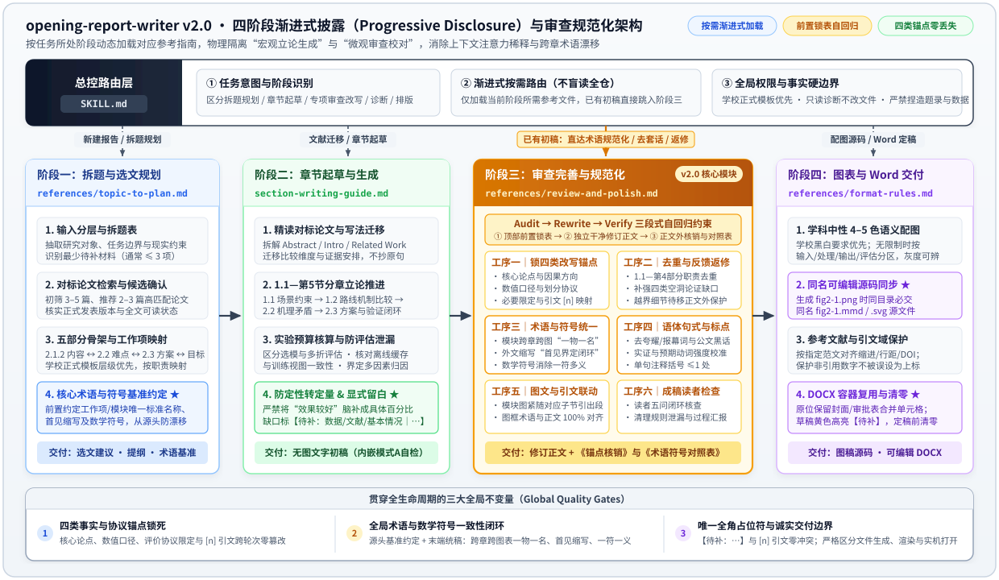

<div align="center">

# opening-report-writer

**面向中文学位论文开题报告的四阶段全生命周期 Agent Skill**<br/>
*拆题选文规划 · 对标论文写法迁移 · 前置锁表审查与术语符号规范化 · 可编辑图稿与 Word 模板交付*

[](https://github.com/henkuaia/opening-report-writer/releases/tag/v2.0.0)
[](https://github.com/henkuaia/opening-report-writer/tree/v1.0)
[](opening-report-writer/SKILL.md)
[](#安装与兼容)
[](#验证与限制)
[](LICENSE)

<br/>


<sub>概念视觉封面，非实际 Word 渲染截图。</sub>

<br/><br/>

[**四阶段架构**](#四阶段解耦架构) ·
[**核心效果对比**](#你会得到什么) ·
[**快速开始**](#快速开始) ·
[**分阶段指令库**](#按任务使用) ·
[**多端安装**](#安装与兼容) ·
[**验证与边界**](#验证与限制)

</div>

---

> [!IMPORTANT]
> **双版本并存说明：** 当前默认 `main` 分支为 **`v2.0`（四阶段解耦与审查规范化版）**。重构前的单阶段稳定版已完整封存至 [`v1.0` 分支](https://github.com/henkuaia/opening-report-writer/tree/v1.0) 与 [Releases (`v1.0.0`)](https://github.com/henkuaia/opening-report-writer/releases/tag/v1.0.0)，支持随时按版本切换或对照。

---

## 为什么需要 `v2.0`？（解决 AI 写开题报告的四大结构性痛点）

通用大模型或单提示词模板在撰写/修改中文开题报告时，普遍面临四个顽疾：

| 常见翻车场景 | 传统单提示词 / 通用润色的表现 | `opening-report-writer v2.0` 的工程化解法 |
| :--- | :--- | :--- |
| **1. 注意力稀释**<br>*(既要立论又要抠字眼)* | 把“怎么搭研究方案”和几十条“去套话、控标点”塞进同一上下文，导致**字面规整但立论肤浅** | **渐进式按需披露（Progressive Disclosure）**：物理拆分为 4 个阶段文件，起草时只加载生成指南，统稿时只加载审查指南 |
| **2. 润色篡改原意**<br>*(越改越丢关键细节)* | 顺手改丢样本量、多折交叉验证协议、“仅在某条件下成立”的限定或 `[3][8]` 引文位置 | **`Audit → Rewrite → Verify` 三段式自回归约束**：动笔前先在输出顶部锁死 4 类事实/协议锚点，用上文注意力约束后续改写 |
| **3. 跨章术语与符号漂移**<br>*(同物异名、一符多义)* | 2.1 叫“跨尺度特征对齐模块”，2.3 变“多尺度融合支路”，图里叫“层次对齐单元”；$N$ 既指患者又指图块 | **源头基准约定 + 阶段三工序三全局统稿**：强制“一物一名”“首见缩写闭环”“数学符号与上下标唯一”，输出《术语与符号统一对照表》 |
| **4. 机器味与凭空脑补**<br>*(套话黑话、定性转定量)* | 满篇“深入剖析、具体如下、赋能、抓手、彻底解决”；把“效果较好”凭空编成“提升了 36.67%” | **论证贡献判定 + 实证动词校准 + 唯一全角占位符**：清理空洞报幕与过度断言，缺失数据强制标 `【待补：数据｜……】` 且定稿前清零 |

---

<a id="四阶段解耦架构"></a>
## 四阶段解耦架构（Progressive Disclosure）

本 Skill 遵循 Agent Skills 渐进式披露规范：主控入口 [`SKILL.md`](opening-report-writer/SKILL.md) 仅负责意图识别、权限底线与路由分发，按任务所处阶段动态加载对应的参考模块：

<p align="center">
  
</p>

### 仓库与安装包目录结构

```text
opening-report-writer-public/
├── opening-report-writer/               # 【核心安装包】复制到客户端 skills/ 目录的唯一子目录
│   ├── SKILL.md                         # 总控入口：任务识别、四阶段路由表与事实/安全底线
│   ├── agents/
│   │   └── openai.yaml                  # 客户端代理元数据配置
│   ├── references/                      # 按阶段按需加载的模块化指南（Progressive Disclosure）
│   │   ├── topic-to-plan.md             # [阶段一] 拆题表、选文流程、五部分骨架、核心术语与符号基准约定
│   │   ├── section-writing-guide.md     # [阶段二] 1.1—第5节起草职责、对标论文写法迁移、实验协议与防泄漏
│   │   ├── research-status-cases.md     # [阶段二·辅助] 1.2 句子功能取舍与多源材料组织示范
│   │   ├── review-and-polish.md         # [阶段三·v2.0] 三种触发模式、Audit→Rewrite→Verify 与六道审查工序
│   │   └── format-rules.md              # [阶段四] 缺口占位符门禁、标点边界、配图源码同步与 Word 容器复用
│   └── LICENSE                          # MIT 许可证（随安装包分发）
├── assets/
│   └── architecture-v2.svg              # v2.0 四阶段渐进式披露与审查规范化矢量架构图
└── tests/                               # 【验收与回归测试套件】不随 Skill 安装
    ├── acceptance.md                    # 验收标准与成熟度边界说明
    ├── public-writing-inputs.md         # 公开测试用例输入（含 v2.0 新增 T25a—T25f）
    ├── public-writing-check.md          # 实际会话输出与逐项判定记录
    ├── check_placeholder_and_assets.py  # 占位符零冲突、括号上限、图稿配对与 T25f 三段式自动断言脚本
    └── check_citation_word.py           # Word 引文编号保护与非引用数字防误伤测试脚本
```

---

<a id="你会得到什么"></a>
## 你会得到什么（真实输入与输出对照）

| 你手头的材料 | 自动路由阶段 | 实际交付产物 |
| :--- | :--- | :--- |
| **只有题目或方向** | 阶段一 | 暂定提纲、逐节核心问题、**《核心术语与数学符号基准约定》**及最少待补材料清单（$\le 3$ 项） |
| **题目 + 文献摘录 / PDF** | 阶段二（内嵌阶段三模式 A 伴随自检） | 围绕共同问题比较机制、条件与证据的连续正文；缺失事实统一标 `【待补：<数据/文献/基本情况之一>｜具体缺什么】` |
| **已有初稿，需统稿 / 去套话 / 返修** | **阶段三（模式 B/C，跳过选文拆题）** | **`Audit → Rewrite → Verify` 三段式交付**：① 前置锁定锚点与术语基准 → ② 独立干净《修订后正文》 → ③ 正文外《改写锚点核销结果》与《术语与符号统一对照表》 |
| **确认后的正文 + 学校 Word 模板** | 阶段四 | 4–5 色语义分区流程图 + **同目录同名 `.mmd`/`.svg` 可编辑源码**；原位复用学校模板容器生成可编辑 DOCX，定稿前清零占位符 |

### 1. 阶段三实测：去 AI 套话 + 跨节术语/数学符号规范化 + 四类锚点锁定

以下展示 [`T25f`](tests/public-writing-check.md#t25f-实际输出阶段三audit--rewrite--verify-三段式锚点锁定--跨节术语符号与动词强度规范化) 中一段同时存在**同物异名漂移、重复括注全称、数学符号一符多义与漂移、AI 黑话套话及过度断言动词**的跨节草稿，如何通过阶段三完成精修：

| 维度 | 改写前初稿（典型病灶） | `v2.0` 阶段三精修后（`#### 修订后正文`） |
| :--- | :--- | :--- |
| **2.1.2 节** | 本课题对病理切片分类**进行了深入剖析，具体如下**：针对总样本量为 **$N=1,240$** 例的患者队列[3]，**以跨尺度特征对齐模块为抓手赋能**表征学习，通过指数移动平均（Exponential Moving Average, EMA）更新教师参数。 | 针对总样本量为 **$N_{\text{pat}}=1,240$** 例的患者队列[3]，本课题**拟构建跨尺度特征对齐模块以增强**切片表征学习，并通过指数移动平均（Exponential Moving Average, EMA）更新教师网络参数。 |
| **2.3.1 节** | 在每张切片采样 **$N=512$** 个图块的设置下，**多尺度融合支路（即图2-1中的层次对齐单元）**再次引入**指数移动平均（Exponential Moving Average, EMA）**计算对齐损失 $L_{\text{align}}$，并写入总损失 $L_{\text{total}} = L_{\text{cls}} + \lambda \mathbf{L_{\text{match}}}$[8]。实验拟在 5 折交叉验证下**（batch=8，且该对比结论仅在弱监督切片级标签条件下成立）跑个消融，以证明本方法彻底解决了多倍率特征割裂痛点**。 | 在每张切片采样 **$N_{\text{patch}}=512$** 个图块的设置下，**跨尺度特征对齐模块（对应图2-1中的同名模块）**利用 **EMA** 教师特征计算对齐损失 $L_{\text{align}}$，并构成总目标函数 $L_{\text{total}} = L_{\text{cls}} + \lambda \mathbf{L_{\text{align}}}$[8]。实验拟在 5 折交叉验证、批大小 batch=8 的设置下**开展消融实验，以验证该模块能否有效缓解多倍率特征割裂问题；上述对比结论仅在弱监督切片级标签条件下成立**。 |

<details>
<summary><strong>点击展开：查看 T25f 完整的 Audit（前置锁表）与 Verify（末尾核销与术语对照表）输出</strong></summary>

> **第一段｜`#### 正文外：前置锁定锚点与术语基准`（动笔前生成，利用自回归注意力约束下文）**
> - **固定事实与协议锚点**：① 核心论点：通过跨尺度特征对齐与 EMA 教师更新改善切片表征并开展消融验证；② 数值口径：患者样本数 `1,240 例`、每张切片采样 `512` 个图块、`5 折交叉验证`、`batch=8`；③ 限定条件：`仅在弱监督切片级标签条件下成立`（拟开展状态）；④ 引文映射：`[3]` 绑定患者队列、`[8]` 绑定总目标函数。
> - **全局术语与符号基准**：① 模块唯一标准名：`跨尺度特征对齐模块`（2.1.2、2.3.1 与图2-1统一）；② 首见缩写：2.1.2 首见界定 `指数移动平均（Exponential Moving Average, EMA）`，2.3.1 仅用 `EMA`；③ 数学符号区分：患者数 $N_{\text{pat}}=1,240$、图块数 $N_{\text{patch}}=512$，对齐损失统一为 $L_{\text{align}}$。
>
> **第三段｜`#### 正文外：改写锚点核销与术语符号统一对照表`（正文后输出，绝不混入正式报告）**
> - 【核心论点】：已保留 2.1.2 与 2.3.1 关于跨尺度特征对齐、EMA 教师更新与消融验证的中心判断，未改变推导方向；
> - 【数值与口径】：已原样保留患者队列 `1,240 例`、每张切片采样 `512` 个图块、`5 折交叉验证` 及 `batch=8`，无定性转定量或凑整；
> - 【限定与协议】：已保留 `5 折交叉验证` 协议，并将原括号内的必要限定条件“仅在弱监督切片级标签条件下成立”拆解融入 2.3.1 末句主干；
> - 【引文映射】：已保留 `[3]` 对应患者队列来源、`[8]` 对应损失函数设计分句，无增删或错位；
> - 【清理项】：已删去“进行了深入剖析，具体如下”空洞报幕套话、“以……为抓手赋能”公文黑话、“跑个消融”口语表达，并将“证明本方法彻底解决了……痛点”降级为匹配开题阶段的“验证该模块能否有效缓解……问题”。
>
> | 类别（工作项/模块/术语/缩写/符号） | 原稿不一致或非标表述 | 统一后标准表述 | 涉及章节/图表位置 |
> | --- | --- | --- | --- |
> | 核心模块名 | 跨尺度特征对齐模块 / 多尺度融合支路 / 层次对齐单元 | 跨尺度特征对齐模块 | 2.1.2、2.3.1、图2-1 |
> | 缩写界定 | 2.1.2与2.3.1连续两次括注 `（Exponential Moving Average, EMA）` | 2.1.2首见界定全称，2.3.1直接使用简称 `EMA` | 2.1.2、2.3.1 |
> | 非标黑话与口语 | 为抓手赋能 / 跑个消融 | 构建……以增强 / 开展消融实验 | 2.1.2、2.3.1 |
> | 过度断言动词降级 | 证明本方法彻底解决了多倍率特征割裂痛点 | 验证该模块能否有效缓解多倍率特征割裂问题 | 2.3.1 |
> | 数学符号（一符多义） | 患者数 $N=1,240$、图块数 $N=512$ | 患者数 $N_{\text{pat}}=1,240$、图块数 $N_{\text{patch}}=512$ | 2.1.2、2.3.1 |
> | 数学符号（前后漂移） | 分步写 $L_{\text{align}}$、总损失写 $L_{\text{match}}$ | 统一为 $L_{\text{align}}$ | 2.3.1 |

</details>

### 2. 阶段二实测：从乱序文献材料到机制比较正文

**输入概况：** 题目是“面向转速变化的设备振动异常报警方法研究”。提供五份乱序摘录，涉及固定阈值、按转速选择阈值、近期观测更新参照，以及互有分歧的误报记录；请求只写研究现状，不补题录、不写本课题方案。以下两段原样摘自 [T21 修改后输出](tests/public-writing-check.md#t21-修改后实际输出)（虚构材料，来自既有会话自测）：

> 甲将低转速正常窗口形成的阈值用于后续所有窗口，不需要在线转速输入；乙分别用两种已知转速的正常窗口校准，运行时根据转速选择对应阈值[材料甲，第1段；材料乙，第1段]。两者都借助事先取得的正常材料，但乙把校准条件与运行条件的对应关系显式加入决策，因而多出转速可获取及相应正常材料可用的要求。甲仅报告低转速测试，乙的S覆盖已知转速及切换，未知转速的选择规则仍未给出。这些条件差异限定了可以讨论的适用范围，不能直接转化为性能高低。
>
> 丙与乙的共同点是参照不再只固定为一个初始范围，区别在于它不读取转速，而用近期振动窗口更新正常范围，再判断后续窗口[材料丙，第1段]。这一更新方式将条件信息的来源从显式转速转向近期观测，因此比较重点也从已知转速是否被校准覆盖，转为更新窗口能否代表正常状态。材料明确更新时不区分正常与异常，由此可提出异常进入窗口可能影响后续参照的假设；持续异常下的报警表现尚未提供，不能将其当成已经观察到的漏报。可见，两类调整方式并非仅有复杂程度差别，而是依赖不同的可用信息和正常性前提。

这里比较的是**正常参照从哪里来、依赖哪些输入、适用于什么条件**，且完整保留了 5 次与 11 次误报的分歧，没有选取有利数字作为稳定成绩。[完整输入与判定条件](tests/public-writing-inputs.md#t21-自行组织乱序材料) · [完整输出与自测判断](tests/public-writing-check.md#实质比较与本轮判定)

<a id="看看写法上的区别"></a>
<details>
<summary><strong>点击展开：章节边界与证据分寸示例（保留合理内容，移出越界方案细节）</strong></summary>

下面来自内置的**虚构教学案例**，用于展示句子取舍，不是论文摘录或运行结果。给定信息：甲在训练和部署时都需要两种输入；乙只在训练时使用辅助输入。现有材料没有可比的精度与速度结果。

- **修改前：** `甲使用两种输入，乙部署时只使用主输入。因此乙更准确、更快。本课题关注单输入部署，拟采用三层网络，并将辅助损失权重设为0.3。`
- **整理后：** `两条路线的区别在于辅助信息是否必须在部署阶段持续可用：甲保持双输入，乙仅在训练阶段使用辅助输入。对于只能取得主输入的部署条件，乙在输入要求上相容；这一判断不等于其精度或速度更优。本课题关注这种训练与部署信息不对称的情形。`
  - **保留成立的内容**：两种路线的输入条件，以及与课题有关的部署约束。
  - **移出方案细节**：网络层数与损失权重留给 2.3 研究方案，不挤占 1.2 研究现状。
  - **不跨越证据边界**：不能从输入数量直接推出精度或速度优势。[查看完整案例与判断依据](opening-report-writer/references/research-status-cases.md)。

</details>

---

<a id="快速开始"></a>
## 快速开始

### 1. 安装 Skill

在提供 `skill-installer` 的 Codex 环境中发送：

```text
请使用 skill-installer，从 GitHub 仓库
henkuaia/opening-report-writer
安装 opening-report-writer 子目录。
先检查是否已有同名 Skill，
不要重复安装或自动覆盖。
```

安装的是仓库**内层** `opening-report-writer/`（包含 `SKILL.md`、`LICENSE`、`agents/` 和 `references/`），不是整个仓库。其他客户端或手动安装见[手动安装说明](#手动安装与同名版本处理)。

<a id="2-确认识别成功"></a>
### 2. 确认识别成功

在客户端的 Skill 列表或选择器中确认出现 `opening-report-writer`。首次调用时可补一句：“请说明本次实际加载的 SKILL.md 路径。”若只按路径读到了文件，但客户端未识别或调用未加载，仍不能算安装检查通过。此时先核对内层目录和同名版本，再尝试重启客户端。

### 3. 发出第一次请求（两种起点任选）

#### 起点 A：从 0 到 1 新建完整开题报告（走阶段一 → 二 → 三 → 四完整闭环）

```text
请使用 $opening-report-writer。

我的题目是：[填写题目]
想解决的问题与拟做工作：[简述，未定可说明]
核心论文或认可的写法范例：[链接/附件，或“没有”]
学校要求与已有基础：[有就提供，没有则说明]

请帮我新建完整开题报告。先复用以上信息，
没有合适论文时主动检索方向接近的论文，
给出来源、适配理由、拟学习章节和全文状态，等我确认。
确认后先约定本课题的核心术语与数学符号基准，精读对标论文的Abstract、Introduction和Related Work连续段落，
围绕我的研究重组无图文字稿（交付前完成阶段三术语符号与锚点自检）；
文字确认后再按需制作配色流程图（同步交付 .mmd/.svg 源码）并整理 Word。
本地日志、未完成实验和内部工作记录不要自动写进正文。
本轮先在对话中交付，不修改文件。
```

| 分轮阶段 | 你先看到什么 | 怎样继续 |
| --- | --- | --- |
| **1. 选参考与立基准** | 初筛 3—5 篇、推荐 2—3 篇对标论文（含适配理由与全文状态）及核心术语/符号约定 | “同意推荐组合，请精读后写第一轮文字稿。” |
| **2. 第一轮文字稿** | 经阶段三伴随自检的连续正文、引用与必要表格，缺失数据以 `【待补：……】` 显式标注 | “文字方向确认，请先处理以下反馈，再配图。” |
| **3. 图文与 Word 整合** | 4–5 色功能分区流程图 + 同名 `.mmd`/`.svg` 源码；有工具时原位复用模板生成 DOCX | 指定模板与保存位置；定稿前核销清零 `【待补】` |

#### 起点 B：手头已有初稿，直接进【阶段三】做术语规范化或去套话精修

不用从头选文或拆题，直接发：

```text
请使用 $opening-report-writer。
我已经有初稿，请直接按阶段三（review-and-polish.md）模式 B 执行全文术语与数学符号规范化及去套话精修：
按 Audit → Rewrite → Verify 三段式输出《前置锁定锚点与术语基准》、《修订后正文》及《改写锚点核销与术语符号统一对照表》。
```

---

<a id="按任务使用"></a>
## 分阶段任务指令库（复制即用）

> [!TIP]
> 只学习、只诊断、只规划时不会自动修改报告文件；需要改写文件或另存新版 DOCX 时，请在请求中明确授权。

### 一、阶段三专项：审查完善、术语规范化与去套话改写（`v2.0` 核心）

<details open>
<summary><strong>1. 全文术语、命名与数学符号规范化（一物一名 + 首见缩写 + 符号对齐）</strong></summary>

当你发现草稿前后模块名称叫法不一、中英文缩写反复重注、或公式变量打架时直接调用（自动跳过选文与拆题阶段）：

```text
请使用 $opening-report-writer。
按阶段三（review-and-polish.md）工序三，对我提供的开题报告草稿执行全文术语与数学符号规范化：
1. 统一跨章节（1.1—第4部分）及路线图、机制图框、表格中的工作项与模块名称，实现“一物一名”；
2. 规范外文术语与缩写为“正文首见界定全称与缩写、后文统一使用简称”；
3. 将口语行话与公文/商业黑话替换为本学科标准学术术语（保留标准技术术语）；
4. 消除数学符号一符多义与分步公式/总目标函数间的上下标漂移。
请按 Audit → Rewrite → Verify 三段式输出：
先列《前置锁定锚点与术语基准》，再给独立的《修订后正文》，最后附《术语与符号统一对照表》。
```

*想要更稳妥地分两步走？只需将末句改为：“本轮先只输出《前置锁定锚点与拟统一术语符号对照表》供我确认，暂不改写正文。”*

</details>

<details>
<summary><strong>2. 去 AI 套话、破八股、控单句括号与实证动词校准（锁死四类事实锚点）</strong></summary>

```text
请使用 $opening-report-writer。
按阶段三（review-and-polish.md）工序一与工序四，改写我提供的段落/章节：
1. 动笔前先锁定四类固定锚点（核心论点、数值与统计口径、必要限定条件与评价协议、引文编号 [n] 映射），严禁篡改、凑整或定性转定量；
2. 清理“深入剖析、具体如下”等夸耀/报幕词与“赋能、抓手、闭环、痛点”等黑话，将“证明了、彻底解决”等过度断言校准为匹配证据强度的学术动词；
3. 保持研究内容、实验组、指标等真并列对象的清晰列项，仅对论述段破除机械序数排比；
4. 除公式/条目编号外，每句注释性小括号控制在 1 处以内，原括号内的必要限定条件拆解融入主句。
请按 Audit → Rewrite → Verify 三段式交付：前置锁定锚点 → 修订后正文 → 改写锚点核销结果。
```

</details>

<details>
<summary><strong>3. 诊断草稿或按导师反馈返修（定位硬伤、移位保护）</strong></summary>

```text
请使用 $opening-report-writer，
按阶段三（review-and-polish.md）诊断我提供的草稿（或根据以下导师反馈修改指定章节）。
按句子功能说明哪些应保留、补充、压缩或移位，明确具体理由。
如果移走越界的方案细节，检查原段落还缺什么比较或证据，并在正文外完整保留待移文本与建议位置。
合理的段落与全部事实/协议锚点请保留。本轮先在对话中交付。
```

收到导师意见时，把**当前草稿、意见原话和允许修改的章节**一起给出（如：“导师说研究现状像流水账、方案只列指标，请依据现有材料改 1.2 和 2.3，其余章节保留”）。

</details>

### 二、阶段一 & 阶段二：拆题规划、范文学习与章节起草

<details>
<summary><strong>4. 只有题目：拆题规划、确立术语基准与识别材料缺口</strong></summary>

```text
请使用 $opening-report-writer。
题目是：[填写题目]。
先在对话中给出拆题表、研究目标、关键问题与本课题《核心术语与数学符号基准约定》，
候选思路保持待确认，事实缺口另列（指出接下来最少要补的三项材料及用途），
不写无来源的研究现状，不修改文件。
```

</details>

<details>
<summary><strong>5. 带材料起草/续写：把文献摘录组织成连续比较正文</strong></summary>

```text
继续使用 $opening-report-writer。
题目沿用上文，只起草研究现状中的一个小节。
材料甲：[出处、页码或章节；粘贴相关段落]
材料乙：[出处、页码或章节；粘贴相关段落]
请先找共同问题和比较维度，再写成连续正文，保留各自成立的条件。
引用对应材料编号；缺失处按格式指南用 `【待补：<数据/文献/基本情况之一>｜具体缺什么】` 标注，不自行补造。
正文之外简短说明关键判断由哪段材料支持。本轮先在对话中交付。
```

</details>

<details>
<summary><strong>6. 学习对标论文或范文：提取段落推进脉络与版式规范</strong></summary>

```text
请使用 $opening-report-writer，
学习我提供的参考论文/报告和当前正式模板。
分别总结章节职责、段落推进、比较维度和格式规则，给出实际来源位置。
说明哪些是共性、哪些存在差异、哪些可以迁移到我的题目。
本轮只学习总结，不修改报告或 Skill。
```

</details>

### 三、阶段四专项：可编辑流程图、参考文献核查与 Word 定稿交付

<details>
<summary><strong>7. 制作 4–5 色语义分区流程图并同步交付可编辑源码（.mmd / .svg）</strong></summary>

```text
请使用 $opening-report-writer。
根据已确认的 2.3 节研究方案正文，按阶段四（format-rules.md#流程图配色与源码交付）制作总体技术路线图与各子节模块机制图：
1. 学校/模板有黑白要求时优先遵循；无限制时按“输入 / 处理 / 输出 / 评估”等学科中性功能角色采用 4–5 色以内语义分区配色，并用实线/虚线保持灰度可辨；
2. 图框内的模块名、特征流向与损失符号须与正文规范化后的标准名称完全一致，不塞入长句或免责套话；
3. 生成渲染图的同时，必须在同目录同步输出同名的可编辑图表代码或源文件（如 fig2-1.mmd、fig2-1.svg）。
```

</details>

<details>
<summary><strong>8. 核查引用与按指定范文排版文末题录</strong></summary>

```text
请使用 $opening-report-writer。
核查我提供报告的参考文献及对应引文（或对照我提供的范文 Word 统一文末参考文献格式）：
1. 核实预印本是否已有支持相同论断的正式发表版本，不把下载渠道当发表身份；
2. 内部日志、脚本和工作笔记不作学术题录，指出哪些正文或题注依赖这些内部材料；
3. 若提供格式参照文件，实际对照两份 Word 统一对齐、缩进、字体、行距和作者缩写，保留原稿并另存新版。
```

</details>

<details>
<summary><strong>9. 整理 Word 定稿：原位复用学校模板容器与占位符清零门禁</strong></summary>

```text
请使用 $opening-report-writer，
按所附学校正式模板整理我的开题报告：
1. 原位复用模板容器，完整保留封面、审批/评议表合并单元格、节属性与样式，仅替换正文并核对封面是否遗留“初稿”标识；
2. 保留公式、图表编号与引用域关系，检查两端对齐下长英文/公式组合是否拉裂字距；
3. 检查全文 `【待补：……】` 占位符是否已全部核销清零（未清零处高亮披露，不冒充定稿）；
4. 另存可编辑 DOCX，并在工具支持时从最终文件渲染、逐页检查，分别报告已生成、已渲染检查与未完成的步骤。
```

</details>

---

<a id="安装与兼容"></a>
## 安装与兼容

核心内容是遵循 Agent Skills 规范的模块化 Markdown 指令与参考指南，不捆绑特定大模型、论文数据库或商业编辑器。

<a id="手动安装与同名版本处理"></a>
### 手动安装与同名版本处理

1. **获取仓库**：克隆本仓库或点击 **Code → Download ZIP** 解压：
   ```bash
   git clone https://github.com/henkuaia/opening-report-writer.git
   # 默认处于 v2.0 (main)；如需切换至 v1.0 单阶段版，可执行：git checkout v1.0
   ```
2. **定位内层安装包**：选择仓库内的 **`opening-report-writer/`** 子文件夹（其下直接包含 `SKILL.md`、`LICENSE`、`agents/` 和 `references/` 共 8 个文件）。
3. **排查同名旧版本**：检查下表对应目录是否已存在同名 Skill，先备份或清理旧目录，避免多版本并存造成加载冲突。
4. **复制到目标客户端目录**：

| 客户端环境 | 个人全局安装路径 | 项目级安装路径 |
| :--- | :--- | :--- |
| **OpenAI Codex** | `~/.agents/skills/opening-report-writer/` 或 `~/.codex/skills/opening-report-writer/` | `<项目根目录>/.agents/skills/opening-report-writer/` |
| **Claude Code** | `~/.claude/skills/opening-report-writer/` | `<项目根目录>/.claude/skills/opening-report-writer/` |
| **Gemini CLI / Antigravity** | `~/.gemini/config/skills/opening-report-writer/` | `<项目根目录>/.gemini/skills/opening-report-writer/` |

*(注：Windows 下 `~` 指当前用户主目录 `C:\Users\<用户名>`；`tests/` 目录为仓库自测与回归套件，不随 Skill 安装。复制后按[确认识别成功](#2-确认识别成功)核验。)*

<details>
<summary><strong>外部工具依赖与降级策略（文献检索、绘图渲染、Word 文档工具）</strong></summary>

| 任务环节 | 可选配合的环境能力 | 环境缺少该工具时的诚实降级策略 |
| --- | --- | --- |
| **题目分析与方案规划** | 无外部依赖 | 直接基于题目与已有输入给出拆题表、提纲与关键缺口 |
| **真实文献检索与精读** | 联网检索工具或用户提供的 PDF / 摘录 | 仅基于已读原文/摘录组织论述，缺失处标 `【待补：文献｜……】`，绝不编造题录 |
| **流程图与机制图制作** | Mermaid CLI / SVG 矢量绘图 / Python 绘图环境 | 交付与正文术语严格一致的 `.mmd`/`.svg` 可编辑源码草稿，如实披露尚未完成位图渲染 |
| **DOCX 生成与视觉检查** | `documents` 工作流、`python-docx`、LibreOffice / Word 渲染工具 | 交付结构化文字稿或已完成解析的 DOCX，明确区分“文件已生成”与“是否已完成逐页渲染视觉检查” |

</details>

---

<a id="验证与限制"></a>
## 验证与限制

本仓库提供可复现的测试用例集与 AST/XML 结构断言脚本，严格区分**已由脚本或会话自测验证的能力**与**尚待独立验证的边界**：

| 检查维度 | 已有验证证据与未验证边界 |
| :--- | :--- |
| **文字与请求路由边界** | 已完成拆题、文献综合、局部修改、模板冲突及材料不足的会话自测（`T1—T24`）；跨模型新会话自动触发尚未做大规模外部基准评测 |
| **选文与分轮写作闭环** | 已实际访问公开会议论文并试写短稿（[选文与分轮自测](tests/reference-workflow-check.md)）；确认节点采用模拟用户回复，未验证真实万字长稿端到端耗时 |
| **引用核查与本地材料隔离** | 已完成组合编号、非引用数字保护、版本取舍及本地材料排除自测（[引文专项自测](tests/citation-format-check.md) + [`check_citation_word.py`](tests/check_citation_word.py)） |
| **`v2.0` 阶段三审查、占位符与图稿源码** | 已完成 `T25a—T25f` 自测与 [`check_placeholder_and_assets.py`](tests/check_placeholder_and_assets.py) 5 项自动断言：<br>① 全角 `【待补：……】` 与 `[n]` 引文零冲突；<br>② 单句注释性小括号 $\le 1$ 处；<br>③ Word 草稿黄色高亮与定稿清零门禁；<br>④ 同目录同名 `.mmd`/`.svg`/`.png` 配对与 $\le 5$ 色校验；<br>⑤ `T25f` 的 `Audit → Rewrite → Verify` 三段式顺序、四类锚点保真、一物一名/首见缩写/数学符号对齐与过度断言动词降级。<br>*(注：真实 Mermaid/SVG 光栅化视觉美观度及 Microsoft Word 实机打开属于脚本未验证范围)* |
| **安装包一致性与链接完整性** | 已验证 `opening-report-writer/` 8 文件结构、三端（公开仓、`.codex`、`.gemini`）SHA-256 哈希一致及全仓 150+ 处内部链接与 `#anchor` 零断链 |

- **测试档案索引**：[优化验收标准](tests/acceptance.md) · [基础输入](tests/inputs.md) · [第一轮自测](tests/session-check.md) · [局部修订稿](tests/revision.md) · [补材料与模板冲突](tests/followup-check.md) · [请求路由检查](tests/task-routing-check.md) · [公开证据与 T25a—T25f 输入](tests/public-writing-inputs.md) · [公开证据与 T25a—T25f 实际输出](tests/public-writing-check.md) · [选文与分轮交付自测](tests/reference-workflow-check.md) · [引用格式与本地材料自测](tests/citation-format-check.md)。

<a id="如何判断改进有效"></a>
> [!NOTE]
> **免责与合规边界：** 默认五部分骨架可按学校要求灵活映射，学校正式模板始终优先。本 Skill 旨在辅助梳理研究脉络、规范学术表达与文档排版，**不承诺创新性成立、查重率、开题答辩通过或论文发表**，亦不可用于规避所在院校或出版机构的 AI 辅助写作披露要求。

---

## 模块阅读导航

| 模块路径 | 所属阶段 | 核心内容说明 |
| :--- | :--- | :--- |
| [`opening-report-writer/SKILL.md`](opening-report-writer/SKILL.md) | **总控入口** | 任务意图识别、四阶段按需读取路由表、事实与权限底线 |
| [`opening-report-writer/references/topic-to-plan.md`](opening-report-writer/references/topic-to-plan.md) | **阶段一** | 输入分层、对标论文检索确认、五部分骨架、核心术语与符号基准约定、论证与可行性补强 |
| [`opening-report-writer/references/section-writing-guide.md`](opening-report-writer/references/section-writing-guide.md) | **阶段二** | 对标论文写法迁移、1.1—第 5 节各章撰写职责、实验预算核算与防评估集泄漏 |
| [`opening-report-writer/references/research-status-cases.md`](opening-report-writer/references/research-status-cases.md) | **阶段二·辅助** | 1.2 国内外研究现状的句子功能判断与多源材料整合示范 |
| [`opening-report-writer/references/review-and-polish.md`](opening-report-writer/references/review-and-polish.md) | **阶段三（v2.0）** | 三种审查触发模式、`Audit → Rewrite → Verify` 三段式机制、六道标准审查与术语/符号规范化工序 |
| [`opening-report-writer/references/format-rules.md`](opening-report-writer/references/format-rules.md) | **阶段四** | 唯一全角占位符与定稿清零、引号与单句括号边界、4–5 色配图与同名源码交付、DOCX 模板复用 |

---

<div align="center">

**[MIT License](LICENSE)** · Copyright (c) 2026 [henkuaia](https://github.com/henkuaia)<br/>
<sub>`opening-report-writer/` 子目录附带独立 MIT 许可文件，支持单独安装与合规再分发。</sub>

</div>
